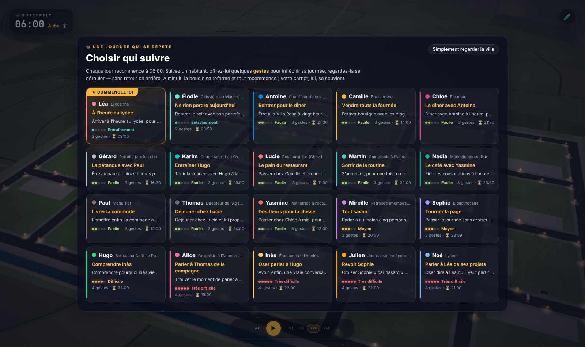
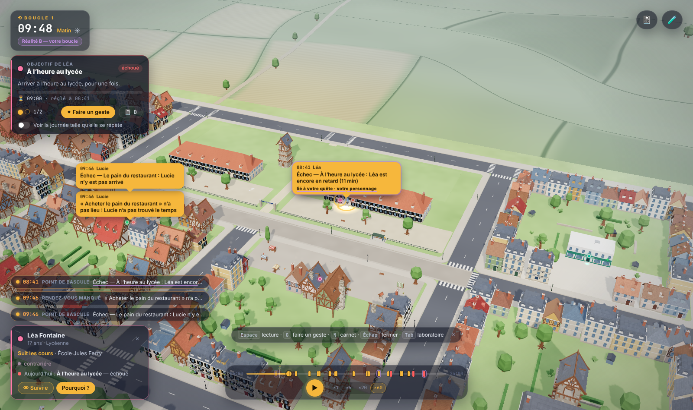
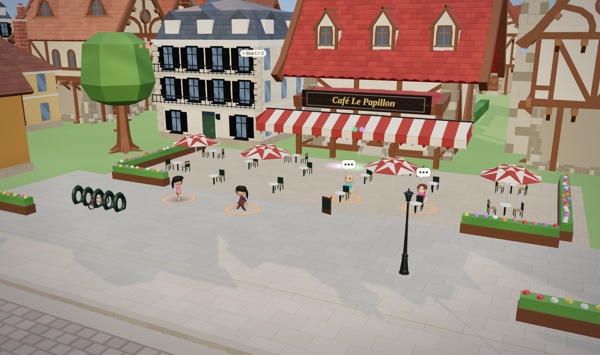

[🇫🇷 Français](README.md) · 🇬🇧 English

# BUTTERFLY

**Twenty inhabitants, one day that keeps repeating. Follow one of them and spend a few gestures to make their day finally work out.**

BUTTERFLY is a deterministic simulation of a small French town: twenty inhabitants, 06:00 to midnight, minute by minute, where every event has recorded causes. You can fork a second timeline, Reality B, by changing one detail ("What if the bus were three minutes late?") and see exactly what changes. The engine has grown into a **time-loop game**: the day repeats, nobody reaches their goal because of twists of fate, and you have a handful of gestures to put things right. Experimental prototype.

The app can be switched between French and English (see [Languages](#languages)); the in-game quotes below are given in French, as in the default interface, with an English gloss.

<table>
  <tr>
    <td width="33%"></td>
    <td width="33%"></td>
    <td width="33%"></td>
  </tr>
  <tr>
    <td align="center"><sub>Choose whom to follow: twenty quests, rated 1 to 5</sub></td>
    <td align="center"><sub>A loop in progress: bubbles, dramatic feed, objective</sub></td>
    <td align="center"><sub>The café in the morning (3D town, CC0 models)</sub></td>
  </tr>
</table>

---

## The game in two minutes

**The loop.** Reality A is the day as it repeats: a choreography in which, by construction, none of the twenty inhabitants reaches their goal. Each of the day's stories carries its **twists of fate** (*coups du sort*): Léa cannot find her bag and misses the bus, an emergency keeps Nadia at her practice, Élodie leaves her wallet at the counter. They are visible events ("Coup du sort : …", i.e. "Twist of fate: …") produced by the same mechanics as your own interventions, only with no one behind them. Some only strike if the inhabitant is in the wrong place, so they can be dodged.

**A run.**

1. You pick an inhabitant on the "Choisir qui suivre" ("Choose whom to follow") screen. Quests are rated from 1 (tutorial) to 5 (very hard); Léa, "À l'heure au lycée" (On time at school), is the training quest.
2. You watch the day unfold **forward only**, in a Reality B, with a small budget of **gestures** per loop (two to four, depending on difficulty). You cannot rewind within a loop.
3. At midnight the loop closes. The summary shows the outcome of the objective (fulfilled, failed, turning point or unfinished), the destinies changed for other inhabitants, and the gestures you used. You can replay the day or switch character.
4. The **notebook** keeps every gesture you have tried with that character, with its outcomes, and replays any of them in one click ("Réutiliser", Reuse) in the next loop.

**What the player sees.**

- **Bubbles** above the characters and a **dramatic feed** (bottom left) that show only what matters: notable or serious events, tagged "lié à votre quête" (linked to your quest) when they concern your character, the person targeted, the objective's location or your story.
- The **objective** card: quest title, deadline, remaining gestures, a "Faire un geste" (Make a gesture) button, the notebook.
- **A/B planning**: the "Voir la journée telle qu'elle se répète" (See the day as it repeats) switch flips to Reality A, always available, so you can spot where the story goes wrong, then back to your loop.
- A **gesture** is typed as free-form French text or picked from quick gestures (delay a bus, keep someone at home, make two people cross paths, force a decision, close a place early, change the weather). It always applies to the future.

**Keyboard.**

| Key | Action |
|---|---|
| <kbd>Space</kbd> (<kbd>Espace</kbd> on the French UI) | play / pause |
| <kbd>G</kbd> | make a gesture |
| <kbd>N</kbd> | open the notebook |
| <kbd>Esc</kbd> (<kbd>Échap</kbd>) | close the open window |
| <kbd>Tab</kbd> | switch between the game (spectator mode) and the laboratory |
| <kbd>+</kbd> / <kbd>−</kbd> | change speed (×1, ×5, ×20, ×60) |

**The tutorial.** In Reality A, Léa is late for school. A single gesture is enough: press <kbd>G</kbd> and type **"Et si Léa partait au lycée à 7 h 30 ?"** (What if Léa left for school at 7:30?). The test `tests/drama.test.ts` checks that no arc is fulfilled in A and that this gesture makes Léa succeed.

### The laboratory

**Laboratory mode** (<kbd>Tab</kbd>) keeps the full analysis: the list of inhabitants, the inspector ("Pourquoi fait-il cela ?", Why is he doing this?), the 06:00–24:00 timeline with event and divergence markers, and the "Et si…" (What if…), Causality, Compare and Report panels. The top bar holds the clock, weather, playback (▶, ×1 ×5 ×20 ×60, "Journée complète" for the full day, jump to a time), the Reality A / Reality B switch and a "⋯ Plus" menu (seed, next day, decision policy, AI status).

The whole day is computed in a few hundred milliseconds when the app opens; playback is a replay, so you can jump to any time and find positions, activities and relationships that were actually simulated. Speed ×1 is real time (one simulated minute lasts 60 seconds); at ×60 the day takes 18 minutes.

| Inspector | Comparing the realities | Causal explorer |
|---|---|---|
|  |  |  |

---

## Running it

Prerequisite: **Node.js 20 or later**.

```bash
npm install --legacy-peer-deps
npm run dev                  # http://localhost:5173
```

No key is required. The whole core (simulation, gestures, comparison, reports, the game) works **offline** with deterministic fallbacks. AI is an optional extra: keys stay on your machine (read by `server/index.ts` from `.env`) and are only sent to the provider you chose. The LLM never modifies the simulated state: it either produces a structured intervention that the engine validates, or rephrases recorded facts.

### AI adapters (optional)

```bash
cp .env.example .env         # then fill in whatever you want to use
npm run server               # port 8787, proxied by Vite under /api
```

| Variable | Purpose |
|---|---|
| `ANTHROPIC_API_KEY` | narration and interpretation of "What if…" requests by an Anthropic model |
| `ANTHROPIC_MODEL` | `claude-haiku-5-5` by default (fast, cheap); `claude-sonnet-5-5` or `claude-opus-5-5` for richer prose |
| `TYPESAFE_API_KEY`, `TYPESAFE_MODEL` | Jev (TypeSafe System One) as a fast decision advisor; `jev-latest` by default |
| `BUTTERFLY_ADVISOR` | forces the advisor: `jev`, `anthropic` or `none` |
| `OLLAMA_URL`, `OLLAMA_EMBED_MODEL` | local embeddings for similarity memory (`http://localhost:11434`, `embeddinggemma`); `BUTTERFLY_EMBED=off` disables the Ollama probe |
| `BUTTERFLY_AI_PORT` | server port (8787) |
| `ANTHROPIC_FALLBACKS` | server-side fallbacks when the model refuses are on by default; `off` disables them |

Without a key, the AI status reads "disabled" and the app uses its fallbacks: the rule-based phrase interpreter, the mock advisor, lexical recall, and factual (un-narrated) reports.

### Commands

```bash
npm test                     # Vitest suite (515 tests)
npm run typecheck            # strict TypeScript
npm run build                # typecheck, then production bundle (dist/)
npm run cli -- --seed 51 --bus-delay 3 --at 09:25     # simulate a day on the command line
npm run cli -- --seed 51 --bus-delay 3 --at 09:25 --agent gerard
npm run cli:advised -- --seed 51 --advisor mock       # a day with an advisor (mock | anthropic | jev)
npm run brain:learn -- --from 1 --to 30               # feed the persistent brain (data/brain.json)
npx tsx scripts/demo.ts 51                            # demonstration scenario (see below)
node scripts/screenshot.mjs [--game | --drama]        # visual walkthrough in Chromium
node scripts/render-check.mjs                         # 3D rendering check (scripted views)
npm run i18n:check                                    # English catalogue coverage
npm run i18n:translate                                # Haiku translates the catalogue (ANTHROPIC_API_KEY)
```

`cli:advised` options: `--advisor mock|anthropic|jev` (the last two read `.env`) and `--embed lexical|ollama|none` for memory recall. `brain:learn` accepts `--file` and `--embed lexical|ollama`.

---

## Languages

The app is available in **French** and **English**. A **FR | EN** toggle switches the language: in the top bar in laboratory mode, as a corner button in spectator (game) mode. Realities are regenerated in the chosen language, because the engine's texts (event labels, mechanisms, memories) are produced at generation time. An English rule-based interpreter also understands gestures ("What if the bus were three minutes late?").

Every string goes through `t(key, params)`; French is the reference language and a key missing in English falls back to French. Two scripts maintain the English catalogue:

```bash
npm run i18n:check           # coverage of the English catalogue against the French reference
npm run i18n:translate       # Haiku translates the French catalogues (ANTHROPIC_API_KEY; model via I18N_MODEL, claude-haiku-5-5 by default)
```

The conventions (keys, namespaces, gender and number, glossary) are in [docs/I18N.md](docs/I18N.md) (in French).

---

## Under the hood

Full details in [docs/ARCHITECTURE.md](docs/ARCHITECTURE.md) (in French).

**Determinism and seed.** All randomness is a hash of (seed, semantic key), for example `encounter:alice:hugo:512`, rather than a sequential generator. The same seed reproduces exactly the same day, and an intervention changes no draw whose situation did not change: a divergence only appears when the situation itself differs. The engine (`src/sim/`) is pure TypeScript with no DOM; rendering only reads it.

**Causal events and A/B comparison.** Every event records its causes, mechanism, effects and random draws. Reality B is a fork: same seed, same initial conditions, one more intervention. `compareRealities` sorts events into identical, shifted, only in A, only in B. A difference is a **verified consequence** if it descends from the intervention in the causal graph; otherwise it is shown as "observed, link not proven" (probable if the inhabitant had already been affected, otherwise undetermined) and never attributed to the intervention without causal support. The causal explorer walks the chain back, with its direct and indirect links.

**Dramaturgy.** Each inhabitant lives one story per day: a desire ("Oser parler à Hugo", Dare to talk to Hugo), sometimes a secret, a tension, a deadline. At the end it is fulfilled, failed or twisted. Ordinary events become highlights and **turning points**; secrets are confided to close contacts and repeated as rumours, and a secret that reaches the person it was hidden from causes a plot twist; **confessions** and **dilemmas** are recorded. **Twists of fate** are interventions with no observer, scheduled when the state is created. Every event carries a **gravity** (0 anecdote, 1 notable, 2 serious, 3 vital) that feeds the player's alerts. After "Jour suivant" (Next day), a fulfilled story gives way to the next one; a failed story is retried with higher stakes (up to three attempts). Design document: [docs/DRAMATURGIE.md](docs/DRAMATURGIE.md) (in French).

**World incidents.** Seven incidents have real mechanics and can be used as gestures or as twists of fate: accident (clinic), fire (place evacuated and closed), theft (wallet, report at the town hall), breakup (partners become exes), dismissal, promotion, illness. Each is a causal event of gravity 2 or 3. The rule-based interpreter understands them ("Et si Paul avait un accident à 10 h ?", "Et si un incendie se déclarait à la boulangerie à 11 h ?", "Et si Chloé et Antoine se séparaient ?", "Et si Alice était renvoyée ?"), as well as "Et si Alice ne quittait pas son appartement ce matin ?", "Et si la boulangerie fermait à midi ?", "Et si la pluie commençait à 14 h ?" or "Et si Léa partait dix minutes plus tard ?" (What if Alice stayed home this morning / the bakery closed at noon / rain started at 2 pm / Léa left ten minutes later?).

**Decisions.** Inhabitants choose through a utility AI (`DecisionPolicy`, `src/sim/decision.ts`) whose scores are readable in the inspector, today's desire included. In "advisor" mode, genuinely open choices (two options with close scores, excluding due commitments and interventions) are arbitrated by an advisor: **Jev** (TypeSafe System One, answers in a few tens of milliseconds, input-only billing; `server/jev.ts`), **Anthropic**, or a deterministic mock advisor. The engine stays sovereign: it builds the options, applies the constraints, validates the answer, and falls back to the utility choice on an invalid or low-confidence reply. Answers are cached to preserve determinism and the A/B comparison. Requests to the advisor also carry the stakes of the day's story, and a second role, the **dramaturge** (`antagonist`, `src/sim/advisor.ts`), picks among plausible options the one that serves the inhabitant's desire least, to keep stories unresolved; that role exists on the advisor side but is not wired into the interface yet.

**Similarity memory and persistent brain.** When an advisor is consulted, BUTTERFLY recalls the relevant memories (similarity 0.55, recency 0.20, importance 0.25; `src/sim/recall.ts`). Similarity comes from free, local embeddings through [Ollama](https://ollama.com), or from a deterministic lexical embedder offline. In addition, **knowledge grains** (situation, cause, effects) are extracted from days and comparisons (`src/sim/knowledge.ts`) and stored in a **local brain** (`data/brain.json`, git-ignored, never sent anywhere; `server/brain.ts`). It can be queried by similarity and feeds imagination, advisors and narration. It informs but never drives: the engine stays deterministic and the A/B comparison exact.

**Narration.** The server offers templates (`day`, `agent`, `causal`, `compare`, `morning`, `dialogue`, `counterfactual`) whose instructions forbid inventing an event, place or motive absent from the recorded facts; dialogue lines, the only imagined part, are flagged as such. Without a key, reports are factual and un-narrated.

**Chained days and street encounters.** "Jour suivant" starts the next day from the final state of the displayed reality (relationships, important memories, money, damped mood, lost wallets). Two pedestrians who cross paths may stop to chat for two minutes, and six tight-margin commitments make the day sensitive to small delays.

**3D rendering and CC0 assets.** The town is built with React Three Fiber (`src/render/`): half-timbered houses, the café and its terrace, the market square, the park, the canal, the bus and twenty animated characters whose paths follow the simulated positions. Models come from Quaternius, Kenney and Poly Haven, all CC0: see [docs/CREDITS.md](docs/CREDITS.md) (in French). The camera zooms from the overview down to street level, with inhabitant following.

**Repository map.** `src/sim/` pure engine · `src/render/` 3D town · `src/ui/` interface (game in `src/ui/game/`) · `src/store/` Zustand state · `src/i18n/` FR / EN catalogues · `server/` AI adapters, brain, embeddings · `public/models/` 3D models · `scripts/` tooling · `tests/` Vitest suite.

---

## Demonstration scenario

The default seed (`DEMO_SEED = 51` in `src/store/useSimStore.ts`) was chosen so that a three-minute bus delay has a real consequence. The causal engine works for every seed and every intervention; the scenario is not scripted. In the laboratory:

1. Start the app (<kbd>Tab</kbd> to switch to the laboratory): it is 06:00.
2. Press ▶ and watch the trips, the bus, the encounters, or click "Journée complète" (Full day) and open "Rapport" (Report).
3. In the timeline, click a bus marker, then in the inspector: "Retarder ce bus de 3 min" (Delay this bus by 3 min). You can also type "Et si le bus avait trois minutes de retard ?" in the "Et si…" panel.
4. Reality B is computed and the "Comparer" (Compare) panel opens: first divergence, verified consequences, changed destinies, per-inhabitant table.
5. Click a consequence, then "Pourquoi cet événement s'est-il produit ?" (Why did this event happen?) to walk the causal chain back to the intervention.

Reproducible with `npx tsx scripts/demo.ts 51` (the same intervention as `npm run cli -- --seed 51 --bus-delay 3 --at 09:25`, with the detail of the consequences). The command prints French text (the demo runs in the default French locale); the statistics are glossed in English and the event lines are the engine's literal output.

**Seed 51**: event « Le bus L1-1 arrive à Arrêt Place du Marché » (bus L1-1 arrives at the Place du Marché stop; 09:25), imposed delay: 3 minutes.

- 3130 identical events, 6 shifted in time, 8 only in A, 14 only in B.
- 18 causally verified consequences of the intervention, affecting 7 inhabitants.
- First consequence: 09:28, Gérard boards bus L1-1 at Arrêt Place du Marché.
- Major consequences: at 19:42 Gérard telling Martin Paul's secret (Paul carved a gift for Camille that he dares not give her) does not happen; at 20:54 Gérard tells Chloé the same secret instead.

Verified consequences (engine output, French; *décalé de +3 min* = shifted by +3 min, *n’a pas eu lieu dans B* = does not happen in B, *seulement dans B* = only in B):

- 09:28 — Gérard monte dans le bus L1-1 à Arrêt Place du Marché *(décalé de +3 min)*
- 09:26 — Antoine et Gérard discutent dans le bus L1-1 *(n’a pas eu lieu dans B)*
- 09:32 — Gérard descend du bus à Arrêt Supermarché *(décalé de +3 min)*
- 09:52 — Gérard oublie son portefeuille à Supermarché Marché Plus *(seulement dans B)*
- 12:15 — Gérard abandonne « Se reposer à la maison » pour « Se détendre au parc » *(n’a pas eu lieu dans B)*
- 14:12 — Gérard abandonne « Se détendre au parc » pour « Se reposer à la maison » *(seulement dans B)*
- 14:38 — Gérard attend Paul (Partie de pétanque) *(décalé de +9 min)*
- 14:35 — Gérard abandonne « Se reposer à la maison » pour « Partie de pétanque » *(seulement dans B)*
- 17:05 — Gérard et Martin discutent à Immeuble Haussmann *(décalé de -20 min)*
- 17:36 — Gérard abandonne « Se reposer à la maison » pour « Se détendre au parc » *(n’a pas eu lieu dans B)*
- 17:37 — Antoine abandonne « Se reposer à la maison » pour « Se détendre au parc » *(n’a pas eu lieu dans B)*
- 19:38 — Gérard et Martin discutent à Immeuble Haussmann *(décalé de -4 min)*
- 19:42 — Gérard rapporte à Martin le secret de Paul : Paul a sculpté un cadeau pour Camille qu’il n’ose pas lui donner. *(n’a pas eu lieu dans B)*
- 20:54 — Chloé fait la connaissance de Gérard à Parc des Tilleuls *(seulement dans B)*
- 20:54 — Gérard rapporte à Chloé le secret de Paul : Paul a sculpté un cadeau pour Camille qu’il n’ose pas lui donner. *(seulement dans B)*
- 20:55 — Antoine et Yasmine discutent à Villa Rosa *(seulement dans B)*
- 21:35 — Nadia et Thomas discutent à Parc des Tilleuls *(seulement dans B)*
- 21:37 — Gérard va dormir *(décalé de -6 min)*

In Reality A, Gérard chats with Antoine on the bus and then does his shopping without incident. In Reality B he boards three minutes later, reaches the supermarket at a different moment of distraction and forgets his wallet at 09:52. His day reorganises itself, he crosses paths with other people, and the secret Paul confided in him (a chain of 56 links from the intervention) no longer travels to Martin but to Chloé, whom he meets in the park at 20:54. Seven inhabitants are affected; the other thirteen live exactly the same day. Since the day is a locked choreography, none of the twenty inhabitants reaches their goal in A: the "Comparer" panel and the report list the changed destinies as soon as a gesture makes one of them succeed.

Every link can be inspected in the causal explorer, and the random draw responsible for the forgotten wallet (`lose:gerard:…`) is shown with its value: the difference comes from a different moment, not from a different "luck".

---

## Documents

All four documents are in French.

- [docs/ARCHITECTURE.md](docs/ARCHITECTURE.md): architecture, simulation step, causality, dramaturgy, advisors, memory, brain, game.
- [docs/DRAMATURGIE.md](docs/DRAMATURGIE.md): dramaturgy design document, with the interaction matrix of Reality A ([docs/interactions-A.csv](docs/interactions-A.csv)).
- [docs/I18N.md](docs/I18N.md): FR / EN internationalisation conventions.
- [docs/CREDITS.md](docs/CREDITS.md): credits and licences of the 3D models.

## Known limitations

- The AI paths (narration, interpretation, the Anthropic and Jev advisors) could not be exercised in the development environment for lack of a key: they are built and tested with mocks and fallbacks. The mock advisor is exercised by the tests.
- 3D performance was only measured with software rendering (no GPU): 180 to 400 draw calls and 1.4 to 2 million triangles per frame depending on distance. To be checked on real hardware.
- The game is tuned for seed 51 (the quests, the twists of fate and Léa's tutorial are verified there); other seeds work, without that balancing.
- The English catalogue is generated (Haiku) and reviewed progressively: some texts may still be approximate or fall back to French ([docs/I18N.md](docs/I18N.md)).
- A single bus line (two vehicles) and 22 locations: the scale is deliberately small to stay readable.
- The decision model is utility-based and hand-tuned; it is designed to be replaced (the `DecisionPolicy` interface).
- Inhabitants have no phones: an abandoned appointment is not announced to the other party, a design choice for the butterfly effect.

## Licence

There is no `LICENSE` file: the code licence has not been set yet, which means all rights remain reserved by the author for now. The 3D models and the HDRI environment are CC0 (Quaternius, Kenney, Poly Haven), as detailed in [docs/CREDITS.md](docs/CREDITS.md).
