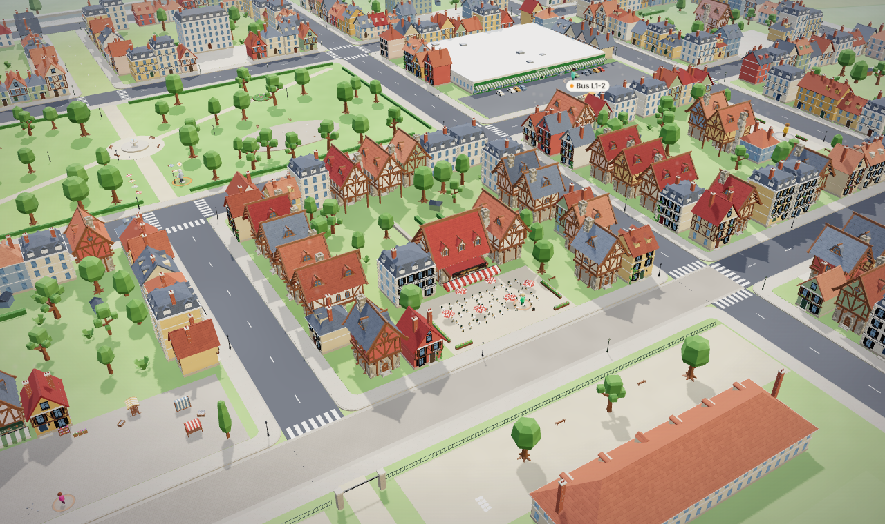
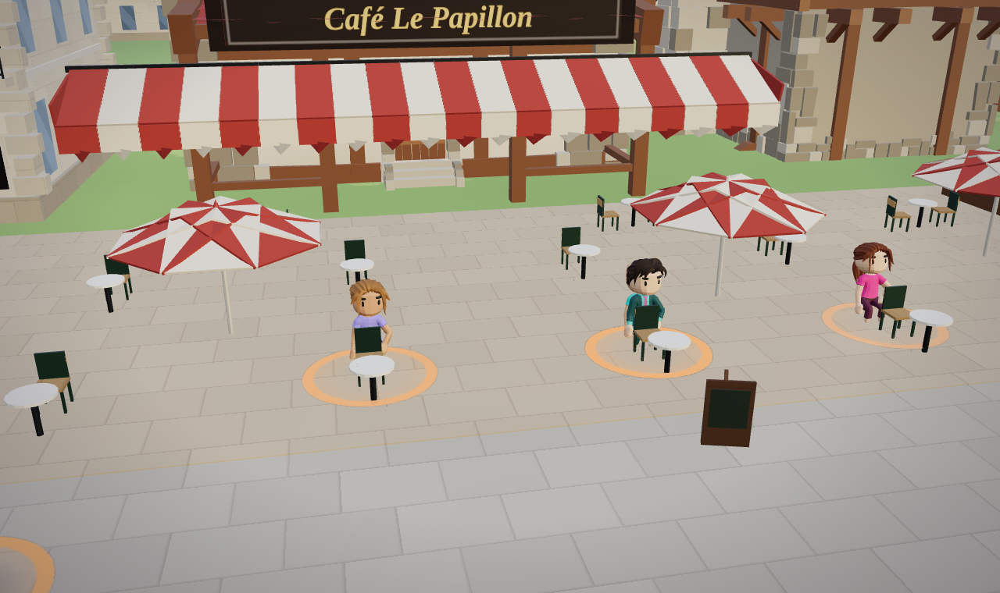
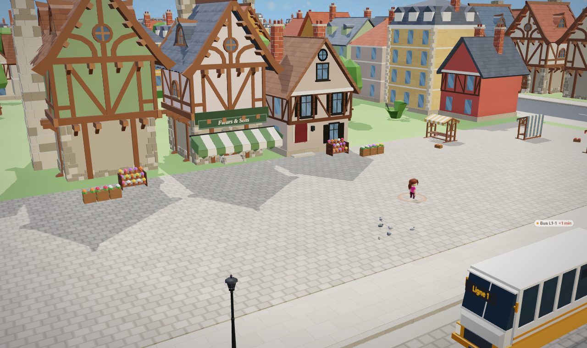
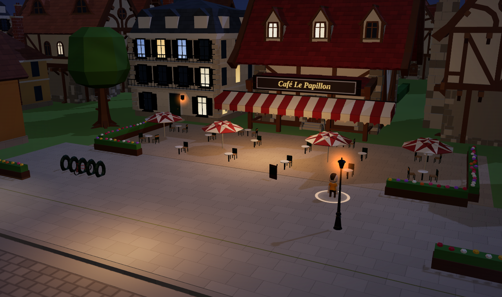
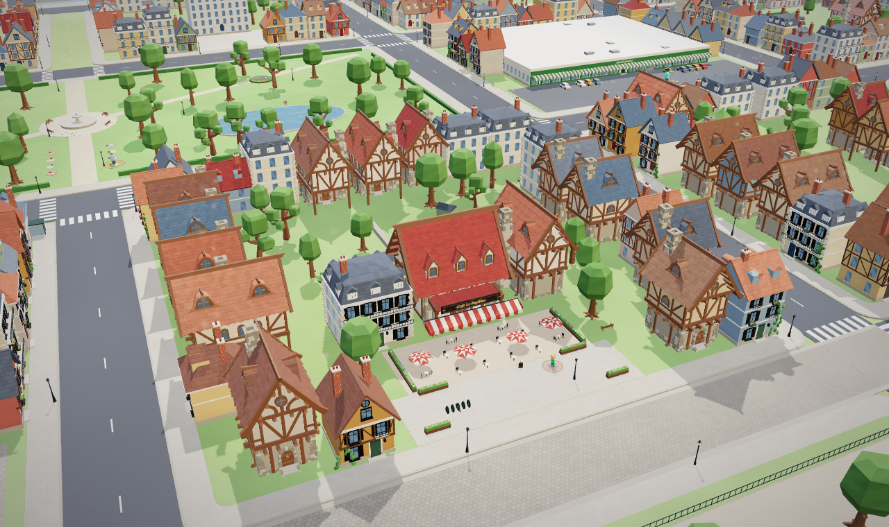
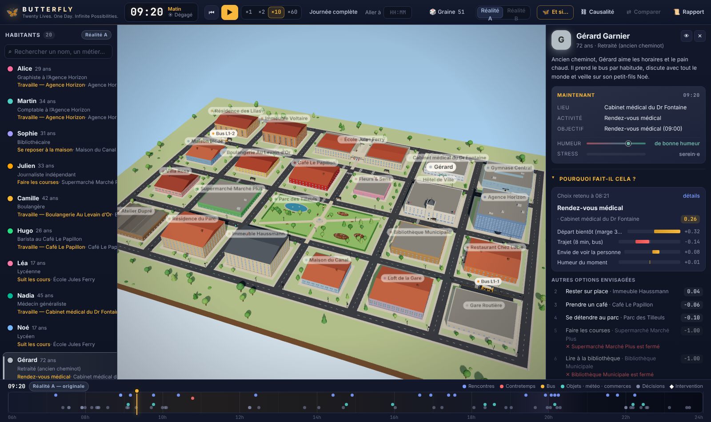
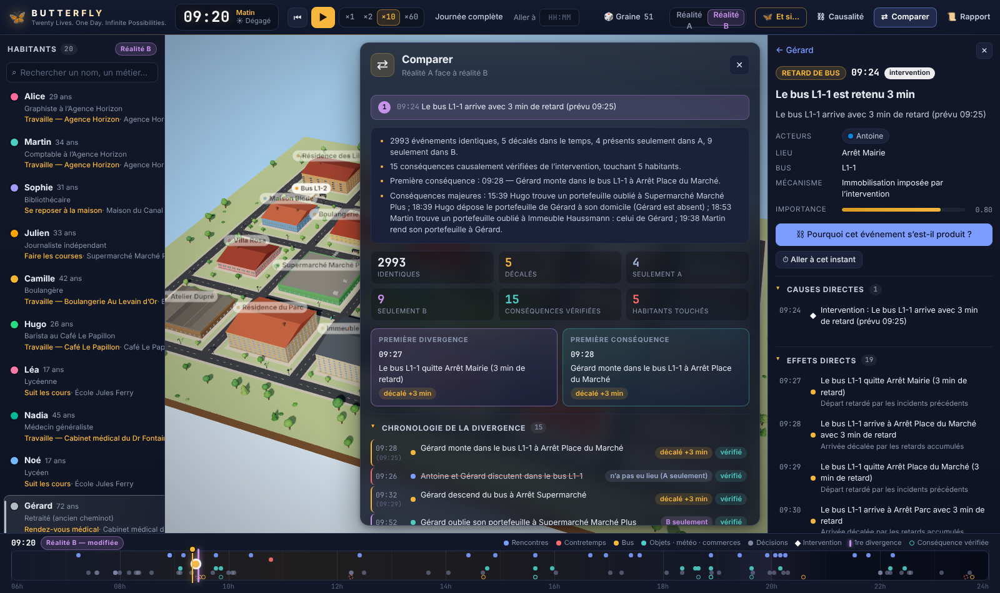
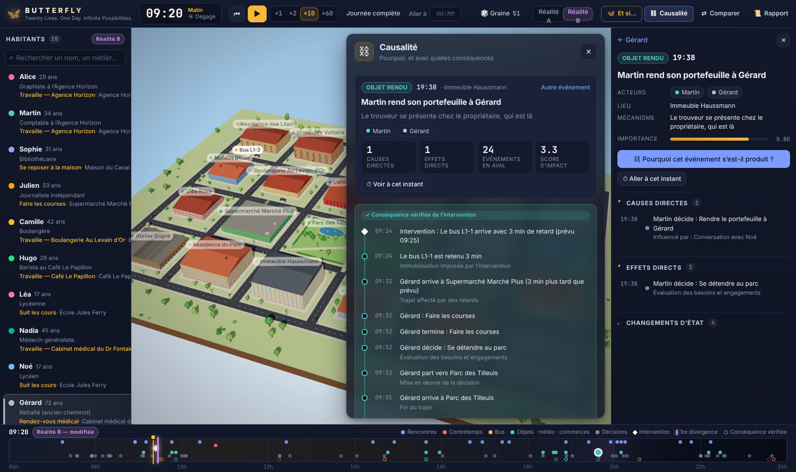

# 🦋 BUTTERFLY

**Twenty Lives. One Day. Infinite Possibilities.**
*Ville vivante autonome & moteur de simulation causale — prototype expérimental.*

Vingt habitants, une ville miniature, une journée de 06:00 à minuit. Chacun se réveille, part travailler, mange, fait ses courses, retrouve des amis, rate un bus, oublie un portefeuille, rentre dormir. Tout est simulé par un moteur déterministe : la même graine produit toujours la même journée.

Puis vous intervenez : **« Et si le bus avait trois minutes de retard ? »** BUTTERFLY crée une seconde réalité, recalcule la journée, et vous montre ce qui a changé — en distinguant les conséquences causalement prouvées des simples coïncidences.

Parfois rien d'important ne change. Parfois deux personnes ne se rencontrent pas. Parfois un portefeuille change de mains et un dîner n'a pas lieu.



| Terrasse du Café Le Papillon | Place du Marché | Le café la nuit |
|---|---|---|
|  |  |  |

| Mode Spectateur | Inspecteur — « Pourquoi fait-il cela ? » | Comparaison des réalités | Explorateur causal |
|---|---|---|---|
|  |  |  |  |

---

## Lancer l'application

Prérequis : Node.js ≥ 20.

```bash
npm install
npm run dev
```

Ouvrez http://localhost:5173. Aucune clé API n'est nécessaire : tout le cœur de l'application (simulation, interventions, comparaison, rapports) fonctionne hors ligne.

### Narration IA (optionnelle)

L'adaptateur LLM tourne côté serveur pour que la clé ne quitte jamais votre machine.

```bash
cp .env.example .env        # puis renseignez ANTHROPIC_API_KEY
npm run server              # port 8787, proxyfié par Vite sous /api
```

Sans clé, le serveur (ou son absence) répond « narration IA désactivée » et l'application utilise ses replis déterministes. Avec une clé, le modèle (par défaut `claude-haiku-5-5`, rapide et économique ; `ANTHROPIC_MODEL` permet de choisir Sonnet ou Opus) interprète vos demandes « Et si… » et peut réécrire les rapports en prose. Le repli serveur (`fallbacks: "default"`) est activé par défaut en cas de refus du modèle ; désactivez-le avec `ANTHROPIC_FALLBACKS=off`. Le LLM ne modifie jamais l'état simulé : il produit une intervention structurée validée, ou reformule des faits enregistrés.

### Autres commandes

```bash
npm test                 # suite Vitest
npm run typecheck        # TypeScript strict
npm run build            # bundle de production (dist/)
npm run cli -- --seed 42 # simule une journée en ligne de commande
npm run cli -- --seed 51 --bus-delay 3 --at 09:25 --agent gerard
node scripts/screenshot.mjs       # test visuel : parcourt la démonstration dans Chromium et enregistre des captures
node scripts/render-check.mjs     # contrôle du rendu 3D : vues scriptées à 08:00, 12:30, 21:30, pluie, survol, mode spectateur
```

---

## Prise en main

| Zone | Contenu |
|---|---|
| Haut | Horloge, période du jour, météo, lecture (▶, ×1 ×5 ×20 ×60, journée complète, aller à…), bascule Réalité A / Réalité B, panneaux, « ⋯ Plus » (graine, jour suivant, politique de décision, état de l'IA), bouton **Spectateur** |
| Gauche | Les vingt habitants, recherche, sélection, suivi caméra |
| Centre | La ville 3D (orbite, zoom, clic sur un habitant) et les panneaux « Et si… », Causalité, Comparer, Rapport |
| Droite | Inspecteur : fiche de l'habitant sélectionné (besoins, émotions, relations, souvenirs, agenda, **Pourquoi fait-il cela ?**) ou fiche de l'événement sélectionné |
| Bas | Chronologie 06:00–24:00 avec marqueurs d'événements et de divergence |

**Vitesse ×1** = temps réel : une minute simulée dure 60 secondes. ×5 et ×20 (par défaut) accélèrent d’autant ; ×60 = une minute simulée par seconde réelle (la journée dure 18 minutes). Touches <kbd>+</kbd> / <kbd>−</kbd> pour changer de vitesse ; la vitesse choisie est mémorisée.

**Deux modes.** Le mode **Laboratoire** garde toute l'analyse (listes, inspecteur, chronologie, panneaux). Le mode **Spectateur** (bouton 👁 ou touche Tab) met la ville en plein écran avec quelques superpositions discrètes : horloge, pilule de lecture, carte contextuelle de l'habitant survolé ou sélectionné. La caméra zoome en continu de la vue d'ensemble jusqu'au niveau de la rue (molette vers le curseur, orbite, double-clic sur un bâtiment pour le cadrer, suivi d'un habitant).

**La ville 3D** est construite à partir d'une palette commune et de modèles libres (CC0) de Quaternius, Kenney et Poly Haven, listés dans [docs/CREDITS.md](docs/CREDITS.md) : maisons à colombages, café et sa terrasse, place du marché, parc avec fontaine et kiosque, canal, bus, et vingt personnages animés (marche, repos, assis, conversations avec bulles) qui suivent les positions calculées par la simulation : trajets lissés (virages arrondis, trottoir de droite, cadence propre à chacun), entrée dans les bâtiments par la porte, et pastille à leur couleur au-dessus de la porte tant qu’ils sont à l’intérieur (la terrasse du café, le parc, les arrêts et la rue restent visibles).

La journée entière est calculée instantanément (quelques centaines de millisecondes) dès l'ouverture ; la lecture est une relecture. Vous pouvez donc sauter à n'importe quelle heure : positions, activités, relations et historiques correspondent à l'état réellement simulé.

## Scénario de démonstration

La graine par défaut (`DEMO_SEED` dans `src/store/useSimStore.ts`) est choisie pour qu'un retard de bus de trois minutes produise une conséquence réelle. Déroulé :

1. Lancez l'application : la ville et ses vingt habitants apparaissent, il est 06:00.
2. Appuyez sur ▶ (×20 par défaut, ×60 pour aller vite) et observez les trajets, le bus, les rencontres.
3. Cliquez « Journée complète » pour aller à minuit, puis ouvrez « Rapport » : la journée de chaque habitant y est résumée.
4. Dans la chronologie, cliquez un marqueur de bus (ou sélectionnez un habitant qui prend le bus et remontez à son événement « monte dans le bus »), puis dans l'inspecteur : **« Retarder ce bus de 3 min »**. Vous pouvez aussi taper « Et si le bus avait trois minutes de retard ? » dans le panneau « Et si… ».
5. La réalité B est calculée et le panneau « Comparer » s'ouvre : première divergence, conséquences vérifiées, différences observées, habitants touchés, tableau par habitant.
6. Cliquez une conséquence puis « Pourquoi cet événement s'est-il produit ? » : l'explorateur causal remonte la chaîne jusqu'à l'intervention (maillons directs et indirects).
7. Basculez Réalité A / Réalité B à la même heure pour voir où chacun se trouve, et relisez l'une ou l'autre.

Le moteur causal fonctionne pour toutes les graines et toutes les interventions ; le scénario n'est pas scripté. Voir « Graine de démonstration » plus bas pour le détail de la chaîne obtenue.

## Graine de démonstration

Résultat obtenu avec la graine par défaut (reproductible avec `npm run cli -- --seed 51 --bus-delay 3 --at 09:25`) :

**Graine 51** — événement : « Le bus L1-1 arrive à Arrêt Place du Marché » (09:25, Arrêt Place du Marché), retard imposé : 3 minutes.

- 3179 événements identiques, 6 décalés dans le temps, 8 présents seulement dans A, 13 seulement dans B.
- 18 conséquences causalement vérifiées de l’intervention, touchant 7 habitants.
- Première conséquence : 09:28 — Gérard monte dans le bus L1-1 à Arrêt Place du Marché.
- Conséquences majeures : 19:42 « Gérard rapporte à Martin le secret de Paul : Paul a sculpté un cadeau pour Camille qu’il n’ose pas lui donner. » n’a pas eu lieu ; 20:54 Gérard rapporte à Chloé le secret de Paul : Paul a sculpté un cadeau pour Camille qu’il n’ose pas lui donner..

Conséquences vérifiées :

- 09:28 — Gérard monte dans le bus L1-1 à Arrêt Place du Marché *(décalé de +3 min)*
- 09:26 — Antoine et Gérard discutent dans le bus L1-1 *(n’a pas eu lieu dans B)*
- 09:32 — Gérard descend du bus à Arrêt Supermarché *(décalé de +3 min)*
- 09:52 — Gérard oublie son portefeuille à Supermarché Marché Plus *(seulement dans B)*
- 12:15 — Gérard abandonne « Se reposer à la maison » pour « Se détendre au parc » *(n’a pas eu lieu dans B)*
- 14:12 — Gérard abandonne « Se détendre au parc » pour « Se reposer à la maison » *(seulement dans B)*
- 14:38 — Gérard attend Paul (Partie de pétanque) *(décalé de +9 min)*
- 14:35 — Gérard abandonne « Se reposer à la maison » pour « Partie de pétanque » *(seulement dans B)*
- 17:05 — Gérard et Martin discutent à Immeuble Haussmann *(décalé de -20 min)*
- 17:36 — Gérard abandonne « Se reposer à la maison » pour « Se détendre au parc » *(n’a pas eu lieu dans B)*
- 17:37 — Antoine abandonne « Se reposer à la maison » pour « Se détendre au parc » *(n’a pas eu lieu dans B)*
- 19:38 — Gérard et Martin discutent à Immeuble Haussmann *(décalé de -4 min)*
- 19:42 — Gérard rapporte à Martin le secret de Paul : Paul a sculpté un cadeau pour Camille qu’il n’ose pas lui donner. *(n’a pas eu lieu dans B)*
- 20:54 — Chloé fait la connaissance de Gérard à Parc des Tilleuls *(seulement dans B)*
- 20:54 — Gérard rapporte à Chloé le secret de Paul : Paul a sculpté un cadeau pour Camille qu’il n’ose pas lui donner. *(seulement dans B)*
- 20:55 — Antoine et Yasmine discutent à Villa Rosa *(seulement dans B)*
- 21:35 — Nadia et Thomas discutent à Parc des Tilleuls *(seulement dans B)*
- 21:37 — Gérard va dormir *(décalé de -6 min)*

Dans la réalité A, Gérard bavarde avec Antoine dans le bus avant de faire ses courses sans incident. Dans la réalité B, il monte trois minutes plus tard, arrive au supermarché dans un autre moment de distraction et oublie son portefeuille à 09:52 ; sa journée se réorganise, il croise d'autres personnes, et le secret que Paul lui a confié ne circule plus vers Martin mais vers Chloé, rencontrée au parc à 20:54. Sept habitants sont touchés ; les treize autres vivent exactement la même journée. Depuis que la journée est une chorégraphie verrouillée (voir « Le jeu »), aucun des vingt habitants n'atteint son objectif en A : le panneau « Comparer » et le rapport listent les destins modifiés dès qu'un geste en fait réussir un.

Chaque maillon est inspectable dans l'explorateur causal, et le tirage aléatoire responsable de l'oubli (`lose:gerard:…`) est affiché avec sa valeur : la différence vient bien d'un autre instant, pas d'une autre « chance ».

## Le jeu : une boucle temporelle

BUTTERFLY se joue comme un film de boucle temporelle. **La réalité A est la journée telle qu'elle se répète** : une chorégraphie où, par construction, aucun des vingt habitants n'atteint son objectif. Chaque histoire du jour porte ses **coups du sort** (`fate` dans `src/sim/drama.ts`) : Léa ne retrouve pas son sac et rate le bus, une urgence retient Nadia au cabinet, Julien vient travailler à la bibliothèque de Sophie, Élodie oublie son portefeuille au comptoir… Ces coups du sort sont des événements visibles (« Coup du sort : … », famille Contretemps) qui utilisent les mêmes mécaniques que les interventions, sans observateur. Certains ne frappent que si l'habitant est au bon endroit (chez lui, dans un lieu public) : on peut donc les esquiver.

**La partie** : on choisit un habitant (Léa, « À l'heure au lycée », sert d'entraînement ; les quêtes sont classées de 1 à 5), puis on regarde la journée se dérouler **vers l'avant seulement** dans une réalité B. On dispose d'un petit budget de **gestes** par boucle (deux à quatre interventions) ; on ne peut pas revenir en arrière dans la boucle, mais la frise de la réalité A reste consultable pour planifier. À minuit, la boucle se ferme : issue de l'objectif, destins modifiés chez les autres, gestes utilisés. Le **carnet** garde tous les gestes déjà essayés avec ce personnage, réutilisables en un clic dans la boucle suivante. Les alertes du mode spectacle ne montrent que ce qui compte : événements notables ou graves, marqués « lié à votre quête » quand ils touchent votre personnage, la personne visée, le lieu de l'objectif ou votre histoire (`src/sim/quest.ts`). Le laboratoire (Tab) garde la vue complète.

Modèle de jeu dans `src/sim/game.ts` (cartes de quête, budget, règles des gestes, boucles, carnet), état persistant dans le navigateur, règle du moteur : `tests/drama.test.ts` vérifie qu'aucun arc n'est accompli en A et que le geste du tutoriel fait réussir Léa.

## Journées enchaînées, conseiller de décision, rencontres de rue

- **Jour suivant** (barre du haut) : le lendemain démarre de l'état final de la réalité affichée (A ou B). Relations, souvenirs importants, argent, humeur amortie et portefeuilles perdus sont conservés ; chaque jour a ses propres flux aléatoires, et les journées passées sont rejouées au rechargement pour reconstruire le jour courant.
- **Décision : utilitaire / conseiller** : en mode « conseiller », les choix réellement ouverts (deux options de scores proches, hors engagements dus et interventions) sont arbitrés par un conseiller via l'interface `DecisionPolicy` (`src/sim/advisor.ts`). Avec une clé API, c'est le modèle (`POST /api/ai/decide`) ; sans clé, un conseiller simulé déterministe joue le rôle pour tester le pipeline. Le moteur reste souverain : il construit les options, applique toutes les contraintes, valide chaque réponse et garde le choix utilitaire pour le reste. Les réponses sont mises en cache par clé stable (habitant, tranche de 10 minutes, options) et la journée est rejouée jusqu'à convergence, ce qui préserve le déterminisme et la comparaison A/B.
- **Rencontres de rue** : deux piétons qui se croisent peuvent s'arrêter bavarder deux minutes ; le retard est enregistré comme cause de leur arrivée.
- Six engagements à marge serrée (viennoiseries du café, club de lecture, fleurs pour la classe, dossier à la mairie, thé entre voisines, livre d'astronomie) rendent la journée plus sensible aux petits retards.

```bash
npm run cli:advised -- --seed 51 --advisor mock        # conseiller simulé, sans clé
npm run cli:advised -- --seed 51 --advisor anthropic   # modèle réel (ANTHROPIC_API_KEY dans .env)
npm run cli:advised -- --seed 51 --advisor jev         # Jev, TypeSafe System One (TYPESAFE_API_KEY dans .env)
```

- **Jev comme conseiller rapide** : Jev (TypeSafe, modèle « System One » de décisions typées) répond à une question à choix fermé par une distribution de probabilités sur les options proposées, en quelques dizaines de millisecondes et avec facturation à l'entrée seulement (≈ 0,04 $ par million de jetons, sortie gratuite). Le serveur (`server/jev.ts`) lui envoie l'état de l'habitant, ses souvenirs récents et les options déjà validées par le moteur ; une réponse qui ne désigne pas une option, ou dont la confiance est trop faible, est ignorée et le choix utilitaire s'applique. Une journée complète coûte de l'ordre d'un à deux centimes. Variables : `TYPESAFE_API_KEY`, `TYPESAFE_MODEL` (`jev-latest` par défaut), `BUTTERFLY_ADVISOR=jev|anthropic|none` pour forcer le conseiller. Le choix du conseiller actif est affiché dans la barre du haut (« Conseiller Jev »).

## Mémoire par similarité (rappel de souvenirs)

Les souvenirs d'un habitant ne sont plus seulement « les quatre derniers » : quand le conseiller de décision est consulté, BUTTERFLY **rappelle les souvenirs pertinents pour la situation** (lieu, personnes présentes, prochain engagement, désir du jour) en combinant similarité sémantique, récence et importance (`src/sim/recall.ts`). La similarité vient d'un modèle d'embeddings **local et gratuit** via [Ollama](https://ollama.com) (par défaut `embeddinggemma`, variables `OLLAMA_URL`, `OLLAMA_EMBED_MODEL`) exposé par le serveur sur `POST /api/ai/embed` ; sans Ollama, un embedder lexical déterministe (sac de mots haché) prend le relais, hors ligne. Les vecteurs sont mis en cache par texte, et le rappel n'influence que ce que voient les conseillers et l'interface : le moteur déterministe n'en dépend pas, la comparaison A/B reste exacte.

```bash
ollama pull embeddinggemma                                   # une fois, sur votre machine
npm run cli:advised -- --seed 51 --advisor mock --embed lexical   # rappel lexical (par défaut)
npm run cli:advised -- --seed 51 --advisor jev --embed ollama     # rappel par embeddings locaux
```

## Le cerveau de la ville : une toile de connaissance qui grandit

Au-delà des souvenirs d'un habitant, BUTTERFLY peut **apprendre d'une partie à l'autre**. À la fin d'une journée simulée et de chaque comparaison A/B, des **grains de connaissance** sont extraits (`src/sim/knowledge.ts`) : situation → cause → effets, toujours tirés d'événements enregistrés. Cinq familles : l'issue des histoires du jour, le chemin des secrets, les chaînes causales les plus influentes, les rencontres marquantes et, surtout, **les interventions et leurs conséquences vérifiées** (« bus retardé de 3 min à 09:25 → Gérard oublie son portefeuille → Noé le rend à 20:24 ; le destin d'Antoine bascule »).

Le serveur les range dans un **cerveau persistant** (`server/brain.ts`, fichier local `data/brain.json`, jamais envoyé ailleurs) : les situations identiques fusionnent et comptent leurs observations, chaque grain est vectorisé (Ollama local ou embedder lexical) et peut être retrouvé par similarité (`POST /api/brain/query`), ingéré (`POST /api/brain/ingest`) ou résumé (`GET /api/brain/stats`, motifs les plus fréquents). Le cerveau **informe** sans jamais piloter : il nourrit l'imagination (quelles interventions ont déjà produit des bascules dans des situations voisines), les conseillers (précédents) et la narration (« ce qui aurait pu arriver », avec de vrais précédents). Le moteur reste déterministe et la comparaison A/B exacte.

```bash
npm run brain:learn -- --from 1 --to 30            # apprend en jouant trente journées (et leur variante « bus en retard »)
npm run brain:learn -- --from 1 --to 30 --embed ollama
```

## Narration : un modèle rapide, des gabarits contraints aux faits

Le serveur propose plusieurs gabarits de narration (`POST /api/ai/narrate`, style `day`, `agent`, `causal`, `compare`, `morning`, `dialogue`, `counterfactual`) : récit de la journée, portrait d'un habitant centré sur son histoire du jour, chaîne causale commentée, comparaison des deux réalités, « Ce matin, dans la ville » (qui veut quoi, qui cache quoi, avant que la journée n'ait lieu), scène dialoguée (répliques imaginées mais limitées aux faits enregistrés, signalée comme telle) et « Ce qui aurait pu arriver ». Le modèle par défaut est `claude-haiku-5-5`, rapide et peu coûteux ; la consigne interdit d'inventer un événement, un lieu ou une motivation absents des faits.

## Dramaturgie : désirs, secrets et points de bascule

Chaque habitant vit chaque jour **une histoire** : un **désir** (ce qu'il veut aujourd'hui, par exemple « Oser parler à Hugo » pour Inès ou « Tenir l'horaire » pour Antoine), parfois un **secret** qu'il cache, une **tension** (ce qui risque d'empêcher le désir) et une **échéance** à partir de laquelle l'histoire se règle d'elle-même. À la fin de la journée, chaque histoire est **accomplie**, **échouée** ou **bouleversée** (coup de théâtre).

- **Temps forts et points de bascule.** Les événements ordinaires deviennent des étapes de l'histoire : un croisement qui n'ose pas aller plus loin, un rendez-vous manqué, un bus qui prend du retard. Ils apparaissent sur la chronologie dans la famille **Drame** : *Temps fort* (l'histoire avance), *Point de bascule* (elle se termine : accomplie, échouée ou bouleversée), *Confidence*, *Rumeur* et *Dilemme*. Chacun cite l'événement qui l'a provoqué : on peut remonter la chaîne causale d'un échec comme celle de n'importe quel autre événement.
- **Les secrets voyagent.** Un habitant peut confier son secret au cours d'une conversation, mais seulement à un proche (ami, famille, couple, béguin) avec lequel l'affinité est assez forte ; celui qui l'a reçu peut à son tour le répéter. Un secret qui atteint **la personne dont il était caché** provoque un coup de théâtre : l'histoire de son propriétaire est bouleversée.
- **Le désir infléchit les décisions.** Il ajoute à certains choix un petit bonus ou malus, d'autant plus fort que l'enjeu est grand et que l'échéance approche. C'est visible dans l'inspecteur, sous « Pourquoi fait-il cela ? », comme composante **« Désir du jour : … »** à côté de la faim, du trajet ou de l'humeur. Quand l'envie et un engagement se disputent presque à égalité, un **Dilemme** est noté.
- **Les histoires s'enchaînent d'un jour à l'autre.** Après « Jour suivant », un habitant dont l'histoire a été accomplie ou bouleversée passe à la suivante ; celui qui a échoué **retente** la même histoire avec des enjeux plus élevés (jusqu'à trois tentatives), et ce qui a été appris des secrets est conservé.
- **Dans le rapport.** La section « Arcs du jour — ce que chacun voulait » résume les vingt histoires, « Confidences, rumeurs et dilemmes » liste les secrets qui ont circulé, et chaque fiche d'habitant raconte son histoire. L'assistant de questions répond à « Quelle était l'histoire de Noé ? ». Dans la comparaison A/B, la ligne **« Destins modifiés »** indique les histoires dont l'issue diffère entre les deux réalités (par exemple « Antoine — « Tenir l'horaire » : accompli en A, échoué en B »).

## Interventions comprises sans LLM

L'interprète par règles reconnaît notamment :

- « Et si le bus avait trois minutes de retard ? » (cible le bus sélectionné ou le prochain passage)
- « Et si Alice ne quittait pas son appartement ce matin ? »
- « Et si Martin décidait de prendre un café plutôt que d'aller travailler ? »
- « Et si la boulangerie fermait à midi ? »
- « Et si Sophie retrouvait son ancien amoureux au parc ? »
- « Et si la pluie commençait à 14 h ? »
- « Et si Gérard oubliait son rendez-vous ? », « Et si Léa partait dix minutes plus tard ? »

Un formulaire structuré permet de composer n'importe quelle intervention sans phrase.

## Architecture

Voir [docs/ARCHITECTURE.md](docs/ARCHITECTURE.md). En résumé :

- `src/sim/` — moteur de simulation pur TypeScript (ville, population, décision utilitaire, événements causaux, bus, réalités, instantanés, comparaison, interprète d'interventions, récit, dramaturgie). Aucune dépendance au navigateur.
- `src/render/` — ville 3D en React Three Fiber : palette et matériaux (`shared.ts`, `materials.ts`), chargement des modèles glTF (`models.ts`), kit de maisons procédurales (`kit.ts`), composition de la ville (`layout.ts`, `town.ts`, `Town.tsx`), personnages animés (`Agents.tsx`, `characters.ts`, `social.ts`, `seats.ts`), bus, rues, éclairage, pluie, caméra (`CameraRig.tsx`, `focus.ts`).
- `public/models/` — bibliothèque de modèles 3D libres (voir `docs/CREDITS.md`).
- `src/ui/` — interface en français.
- `src/store/` — état applicatif (Zustand).
- `server/` — adaptateur LLM optionnel.
- `tests/` — suite Vitest (reproductibilité, horloge, déplacements, exclusivité, chronologie causale, branchement, relecture, divergence, interprète, récit, dramaturgie).

## Limites connues

- Une seule ligne de bus (deux véhicules) et une ville de 22 lieux : l'échelle est volontairement petite pour rester lisible.
- Le modèle de décision est utilitaire et réglé à la main ; il est conçu pour être remplacé (interface `DecisionPolicy`) et un conseiller (simulé ou LLM) peut arbitrer les choix ouverts.
- Les performances 3D n'ont été mesurées qu'en rendu logiciel (environnement sans GPU) : 180 à 400 appels de dessin et 1,4 à 2 millions de triangles par image selon la distance ; à vérifier sur une machine réelle.
- Le chemin « conseiller IA » a été construit et testé avec le conseiller simulé ; l'appel réel au modèle n'a pas pu être exercé dans l'environnement de développement (aucune clé disponible).
- Les habitants n'ont pas de téléphone : un rendez-vous abandonné n'est pas annoncé à l'autre partie (c'est un choix de conception pour l'effet papillon).
- La narration IA dépend d'une clé API ; sans clé, les rapports sont factuels et non narrés.
